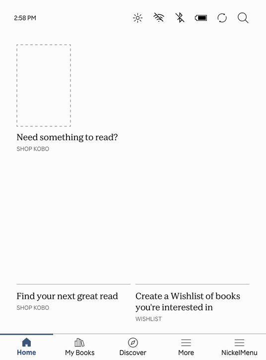
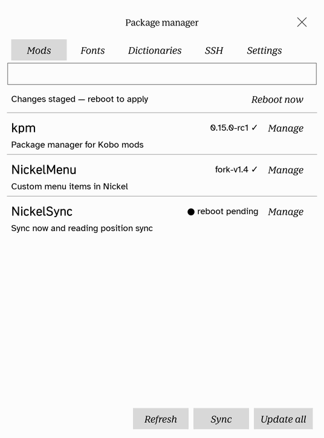

# kpm: Kobo package manager

kpm installs, updates and removes mods on Kobo e-readers. It reads releases from GitHub, Codeberg or any Gitea or Forgejo server, stages the packages for the next boot, and updates itself the same way.

kpm is one static Go binary plus a small UI inside Nickel (NickelKPM). Use the UI on the device, or the CLI over SSH.



*Recorded in the `kfw vm` emulator on firmware 6.0.279225, with a local test registry.*

- Works on firmware 4.x (Qt 5) and 6.x (Qt 6). One `Kobo.tgz` installs on both.
- Keeps your mods across the upgrade from 4.x to 6.x, with no user step.
- Opens from a "Package manager" row on the More page. NickelMenu is optional.
- Installs mods, KOReader, Plato, fonts and dictionaries.
- Reads package lists from registries, for example [wolffshots/kobo-registry](https://wolffshots.github.io/kobo-registry/).
- Has a built-in SSH server (`kpm ssh`).

> kpm does not check signatures. To install a package is to trust its author, as with a manual `KoboRoot.tgz`. kpm downloads over HTTPS only, with an embedded Mozilla CA bundle, and checks each archive before it stages it. See [Security](#security).

## Contents

- [Install](#install)
- [First run](#first-run)
- [Open kpm](#open-kpm)
- [Firmware 4.x and 6.x](#firmware-4x-and-6x)
- [Self-update](#self-update)
- [CLI](#cli)
- [Registries](#registries)
- [Uninstall](#uninstall)
- [Troubleshooting](#troubleshooting)
- [Files on the device](#files-on-the-device)
- [More documentation](#more-documentation)

## Install

1. Download `Kobo.tgz` from the [latest release](https://github.com/wolffshots/kpm/releases/latest).
2. Connect the Kobo over USB.
3. Copy `Kobo.tgz` into the hidden `.kobo` folder of the Kobo drive.
4. Eject the Kobo. It installs kpm at the next boot.

`Kobo.tgz` works on firmware 4.x and 6.x. The release also has `KoboRoot.tgz`, which works on 4.x only. Firmware 6.x reads only `.kobo/Kobo.tgz`.

Over SSH, copy the file and reboot:

```sh
scp Kobo.tgz root@<kobo>:/mnt/onboard/.kobo/Kobo.tgz
ssh root@<kobo> reboot
```

The binary is `/mnt/onboard/.adds/kpm/bin/kpm`. It is not on the `PATH` of the device. Over SSH, add it:

```sh
export PATH="$PATH:/mnt/onboard/.adds/kpm/bin"
```

NickelDBus (`qndb`) is optional. With it, the NickelMenu entries of kpm show toasts.

## First run

kpm starts with no registry, so the package list holds only kpm. Add a registry first.

Over USB, create `.adds/kpm/config.toml` on the Kobo drive:

```toml
[[registries]]
name  = "main"
url   = "github.com/wolffshots/kobo-registry"
forge = "github"
```

Or over SSH:

```sh
kpm registry add https://github.com/wolffshots/kobo-registry --name main
```

Then, on the Kobo:

1. Tap **More**, then **Package manager**.
2. Tap **Refresh**. kpm gets the package list.
3. Tap a package, then **Install**.
4. A mod installs at the next boot. Tap **Reboot now**, or **Later** to stage more packages first.

KOReader, Plato and dictionaries install at once, with no reboot. A font needs a reboot before Nickel uses it.

### Mods that are already on the device

Tell kpm the version that you have, so that it tracks the mod and does not install it again:

```sh
kpm registry refresh
kpm install nickelmenu --installed v0.6.0 --yes
```

## Open kpm



By default, kpm adds a **Package manager** row to the Nickel **More** page, above Help. The row needs no NickelMenu and hooks no Nickel function.

The **Settings** tab of the UI has two settings. kpm stores them in `.adds/kpm/ui.toml`.

| Setting | Values | Effect |
|---|---|---|
| Open kpm from | **Row on the More screen** (default), **NickelMenu** | One of the two shows, never both. The change applies at the next open of the More page or of NickelMenu. Without NickelMenu, the row always shows. |
| NickelMenu button | **Shown** (default), **Hidden** | Hides the NickelMenu button in the bottom bar of the home screen. Only when kpm opens from the More row. Restart the device after a change. |

With "Open kpm from: NickelMenu", the kpm entries in the NickelMenu main menu are active:

| Entry | What it does |
|---|---|
| kpm - Check for updates | Connects Wi-Fi and runs `kpm check --notify`. |
| kpm - Update all | Connects Wi-Fi and runs `kpm update --all --reboot --notify`. The device reboots when it is done. |
| kpm - Status | Shows the last summary (offline). |
| kpm - Package manager | Opens the UI (`kpm ui`). |

With the More row, the hook comments out these entries at each boot (prefix `#kpm-off `). To hide the NickelMenu button, the hook writes `.adds/nm/kpm-hide` with `experimental:menu_main_15505_enabled:0`. NickelMenu v0.6.0 and the Qt 6 fork read this line at start. The NickelMenu items in the reading menu and the library menu stay.

### What the UI does

- Tabs: **Mods**, **Fonts**, **Dictionaries**, **SSH** and **Settings**. The search box filters the active tab.
- **Refresh** gets the registry lists and checks for updates. **Update all** stages all updates. **Sync** copies registry defs into `packages.d`, so an installed package gets fixed uninstall recipes and new config entries (`kpm sync`).
- A package page has **Install**, **Update** or **Uninstall**. A package with config files also has **Settings**, which edits the values with `kpm config set` and keeps the comments in the file.
- If kpm self-update is off, the kpm page has **Enable self-update**.
- All work runs in the `kpm` binary. If the binary is missing, the UI shows "kpm not found" and does nothing else.

### Safety of the More row

- If Nickel crashes within 3 seconds after the row first shows in a boot, the file `.adds/kpm/.more-row-pending` stays. The same hook build then shows no row from the next boot. kpm opens from NickelMenu, with its entries active and the NickelMenu button shown. A new kpm build deletes the file and tries again.
- If a More page shows without its Help row, the hook switches the setting to NickelMenu.
- The hook checks each Nickel symbol that it needs when it loads. If one is missing, it does not load, and Nickel runs as usual. A crash within 15 seconds of load makes NickelHook turn the hook off at the next boot.

The hook passes `kfw check` on firmware 4.45.23697, 4.45.23792, 4.46.23836, 4.46.23852, 5.18.270971, 6.0.274403 and 6.0.279225. Firmware 4.20.14601 and older fail the symbol check, so the UI does not load there. The CLI still works.

## Firmware 4.x and 6.x

Firmware 6.x uses Qt 6. It reads only `.kobo/Kobo.tgz` and extracts it into `/usr/local/Kobo`. `Kobo.tgz` holds a Qt 5 and a Qt 6 build of the hook, and each Qt loads only its own build. At boot, the hook copies the kpm binary, `packages.d/kpm.toml` and the NickelMenu entry from `/usr/local/Kobo/kpm-seed` to the user partition, when the seed version changed.

kpm reads the firmware version from `.kobo/version`. Major 4 is the 4.x line, major 6 and later is the 6.x line. For any other major, such as 5.x, the Qt 6 core library in `/usr/lib` decides.

On 6.x:

- kpm stages `.kobo/Kobo.tgz` in place of `.kobo/KoboRoot.tgz`.
- A mod installs only when its def has an `[fw6]` table. Else kpm shows "no build for firmware 6.x", and `update --all` skips it.
- KOReader, Plato, fonts and dictionaries install on both lines.
- A package that 6.x has built in, such as NickelClock, is not available. kpm removes it at the first mutating run on 6.x.

### After a firmware update

A firmware update writes a new rootfs. The mod files on the rootfs, the kpm hook and NickelMenu are gone. The user partition stays, with `.adds/kpm`.

At the first mutating run after the update, kpm:

- marks a package as not installed when all of its rootfs files are gone, so that `kpm update --all` installs it again with the asset of the new line,
- marks itself for a reinstall when its hook is gone (`kpm check` shows "REINSTALL (files missing)"),
- syncs a def with no `[fw6]` table from the registry cache, when the registry def has one,
- deletes a `KoboRoot.tgz` that it staged and that the new firmware does not read.

### The upgrade from 4.x to 6.x

On 4.x, kpm keeps your mods across the upgrade to 6.x. You do not have to do anything.

- kpm keeps a bundle, `.adds/kpm/carryover/Kobo.tgz`, with the 6.x build of kpm and of each installed package that has an `[fw6]` table. `check`, `update`, `install` and `uninstall` keep it current. `kpm carryover` builds it now and shows what it holds.
- kpm adds a short block to the 4.x shutdown script `/etc/init.d/rcK`. The block acts only during the upgrade, when `.kobo/updateQt5ToQt6` and `.kobo/update.tar` exist. It then copies the bundle to `.kobo/Kobo.tgz`.
- The first 6.x boot installs the bundle, so kpm, NickelMenu and your other mods load at once. kpm records them as installed.

A package with no 6.x build is not in the bundle. An update from 6.x to 6.x is not covered.

### If kpm does not start after a firmware update

1. Copy `Kobo.tgz` of kpm into `.kobo/` and eject. The UI comes back.
2. Open the UI and tap **Update all**. kpm installs the 6.x build of each package again.

Over SSH, `kpm update --all` does both steps.

## Self-update

kpm ships with self-update off. `kpm status` shows "self-update not configured". This is not an error.

To turn it on, add a registry that offers kpm, then tap **Enable self-update** on the kpm page of the UI, or run:

```sh
kpm adopt-self
```

kpm then updates itself like any other package. kpm stores its source and pin in `state.json`, so a self-update keeps them. On 6.x, a self-update stages the `Kobo.tgz` of the release, and the seed copies the new binary at the next boot.

## CLI

Common tasks:

| Task | Command |
|---|---|
| See what is installed | `kpm list` |
| Look for updates | `kpm check` |
| Install all updates and reboot | `kpm update --all --reboot` |
| Find a package | `kpm search [<term>]` |
| Install a package from a registry | `kpm install <id> --yes`, then `kpm update <id> --reboot` |
| Add a package by URL | `kpm add <url>` |
| Hold a version | `kpm pin <id> <tag>`, `kpm unpin <id>` |
| Cancel a staged install | `kpm unstage` |
| Check that a mod loaded | `kpm doctor [<id>]` |
| See the history | `kpm log [-n N]` |

All commands:

```
kpm add <url> [--asset <glob>] [--forge github|forgejo] [--name <id>] [--installed <ver>]
kpm remove <id>              (unregister only: see "kpm uninstall" to delete files)
kpm uninstall <id> [--purge] [--dry-run] [--yes] [--force] [--keep-registration] [--reboot] [--notify]
kpm list
kpm check [--notify]
kpm update [<id>...] [--all] [--reboot] [--notify]
kpm unstage                  (cancel a pending staged update)
kpm pin <id> <tag>
kpm unpin <id>
kpm registry add <url> [--name <n>] [--ref <branch>] [--path <p>] [--forge github|forgejo]
kpm registry remove <name>
kpm registry list
kpm registry refresh [<name>]
kpm search [<term>]
kpm doctor [<id>]            (diagnose whether installed Nickel plugins actually loaded)
kpm install <id> [--pin <tag>] [--installed <ver>] [--yes] [--adopt]
kpm adopt-self               (enrol kpm's own self-update from a configured registry)
kpm sync [<id>...] [--overwrite]
kpm config list <id>
kpm config show <id> <name-or-index>
kpm config set <id> <name> --key K [--section S] --value V
kpm config set <id> <name> --line N --value V [--append|--delete]
kpm config init <id> <name-or-index> [--force]   (create a file from its example template)
kpm log [-n N]
kpm status
kpm carryover                (firmware 4.x: build the bundle that keeps the mods on the upgrade to 6.x)
kpm ui                       (open the graphical package manager; used by NickelMenu)
kpm ssh <enable|disable|start|stop|restart|status|install> [--json] [--keys <file>] [--port N]
kpm version
```

Exit codes: `0` OK or nothing to do, `1` error, `2` partial (some packages failed, others staged), `3` confirmation required (`install` or `uninstall` without `--yes`). If every package of an `update` fails, the exit code is `1`.

Most commands accept `--json`. See [docs/development.md](docs/development.md#machine-readable-output).

After a reboot, the next mutating command (for example `kpm check`) moves staged packages to installed. `kpm status` is read-only and does not do this. After that move, kpm checks that the files of each package are on the device, and logs a `WARN` for each missing file.

`kpm doctor` tells you if an installed mod really loaded. It checks each NickelHook plugin for a failsafe file, a crash log, and whether Nickel mapped it. It reports `loaded`, `not-loaded`, `crashed`, `load-failed` or `unknown`. It reads only files and `/proc`, and it always exits 0.

## Registries

A registry is a git repository with a `registry.toml` of package definitions. It holds no binaries. Each package still comes from its own release page.

```sh
kpm registry add https://github.com/owner/kobo-registry --name main
kpm registry refresh        # the only registry command that uses the network
kpm search nickel
kpm install nickelmenu      # prints the def and exits 3, so you can review it
kpm install nickelmenu --yes
```

To trust a registry is the same decision as to add each of its packages by hand. Its uninstall recipes run as root. [docs/packages.md](docs/packages.md) describes the def format, the registry format, checksums, conflicts and the install methods.

### Private repositories

kpm can read a private GitHub registry or package repository with a GitHub token. Put it at the top of `.adds/kpm/config.toml`, above the `[[registries]]` tables:

```toml
github_token = "github_pat_..."
```

Make a fine-grained token that can only read:

1. Open https://github.com/settings/personal-access-tokens/new.
2. Give it a name for the device, and set an expiration.
3. Under **Repository access**, select **Only select repositories** and pick the private repositories.
4. Under **Repository permissions**, set **Contents** to **Read-only**. Leave the rest at **No access**.
5. Generate the token and copy it. GitHub shows it only once.

- kpm sends the token only over HTTPS to `api.github.com`, `raw.githubusercontent.com` and `github.com`. A redirect to the GitHub storage host does not carry it.
- The token also raises the GitHub rate limit from 60 to 5,000 requests an hour.
- When the token expires, each GitHub package fails with `GitHub rejected github_token in .adds/kpm/config.toml`. Replace or remove the key.
- A person with USB access to the Kobo can read `config.toml`. Keep the scope of the token small.

## SSH

`kpm ssh` is an SSH server in the kpm binary, for root logins with a public key. It replaces NiLuJe usbnet.

1. Add your public key to `.adds/authorized_keys` on the Kobo drive.
2. Tap **Enable** on the **SSH** tab, or run `kpm ssh enable`.
3. Log in with `ssh root@<device address>`. The SSH tab shows the address and the host key fingerprint.

[docs/ssh.md](docs/ssh.md) has the details: sftp and scp, Force Wi-Fi, limits, and the move from Dropbear.

## Uninstall

### A package

In the UI, open the package and tap **Uninstall**. On the CLI:

```sh
kpm uninstall <id>           # prints the plan and exits 3
kpm uninstall <id> --yes     # applies it
```

`--purge` also deletes the user data of the package. `--reboot` reboots after it. Some mods remove themselves at the next boot. `kpm remove <id>` only forgets the package and keeps its files. See [docs/packages.md](docs/packages.md#uninstall) for the recipes and the path rules.

### Only the UI

Create the file `/mnt/onboard/kpm_ui_uninstall` and reboot. At the next boot the hook deletes both hook builds and the `kpm-seed` folder, stops `kpm ssh`, activates the NickelMenu entries and deletes `.adds/nm/kpm-hide`. The kpm binary, config, state and packages stay.

### kpm itself

`kpm uninstall kpm` is refused. Remove kpm by hand:

1. On 4.x, over SSH, delete the lines from `# kpm carry-over: begin` to `# kpm carry-over: end` in `/etc/init.d/rcK`. Without the bundle the block does nothing, so you can also skip this step.
2. If you use `kpm ssh`, run `kpm ssh disable`.
3. Remove the UI with `kpm_ui_uninstall` and reboot (see above). This also removes the `kpm-seed` folder, which can copy the binary back at boot.
4. Over USB, delete `.adds/kpm` and `.adds/nm/kpm`. Keep `.adds/kpm/ssh/` if you want the same host key after a new install.

## Troubleshooting

- **Cancel a staged update.** Run `kpm unstage` before the reboot. Do not delete `.kobo/KoboRoot.tgz` or `.kobo/Kobo.tgz` by hand: kpm still thinks the packages are staged.
- **A mod is "up to date" but does nothing.** Run `kpm doctor <id>`.
- **Junk "books" from `.adds` in the library (firmware 4.17 and later).** Add the line below to `.kobo/Kobo/Kobo eReader.conf` over USB, with the Kobo idle. kpm does not edit this file, because Nickel writes it again. `kpm doctor` checks for the line.

  ```
  [FeatureSettings]
  ExcludeSyncFolders=(\\.(?!kobo|adobe).+|([^.][^/]*/)+\\..+)
  ```

- **"conflicts with installed package".** The registry says that the two packages cannot both be installed. Run the `kpm uninstall` command that the message names, then try again. `--yes` does not override it. `kpm update --all` skips the package with a note.
- **"checksum mismatch for asset".** The downloaded file does not match the hash in the registry. kpm deletes the file and does not install it. Tell the registry curator.
- **Corrupt `state.json`.** kpm renames it to `state.json.corrupt-<time>`, logs a `WARN` and starts with an empty state. Give the installed versions again with `kpm add <url> --installed <ver>`. kpm finds its own version.
- **The log.** `.adds/kpm/kpm.log` rotates to `kpm.log.1` at 256 KiB. `kpm log` reads only the current file.
- **The UI does not open.** Check `.adds/kpm/.more-row-pending` (see [Safety of the More row](#safety-of-the-more-row)), and that `/usr/local/Kobo/imageformats/libnkpm.so` (4.x) or `libnkpm-qt6.so` (6.x) exists. A firmware update removes them. Install `Kobo.tgz` again.

## Files on the device

```
/mnt/onboard/.adds/kpm/
  bin/kpm              the static ARM binary
  packages.d/          one TOML file per package (kpm.toml is kpm itself)
  config.toml          registries and github_token
  ui.toml              the Settings tab
  state.json           installed and staged versions, manifests, last check
  kpm.log              the history
  status               the last summary (NickelMenu "Status")
  cache/               downloads and registry caches
  carryover/Kobo.tgz   firmware 4.x: the bundle for the upgrade to 6.x
  ssh/                 kpm ssh: host key, config, keys, log
/mnt/onboard/.adds/nm/kpm          the NickelMenu entries
/usr/local/Kobo/imageformats/      libnkpm.so (Qt 5), libnkpm-qt6.so (Qt 6)
```

## Security

- kpm downloads over HTTPS only. It refuses a redirect to plain HTTP. It uses an embedded Mozilla CA bundle.
- kpm checks each archive before it stages it. It refuses absolute and `..` paths, links that point outside the archive, device and FIFO entries, and setuid or setgid files. No package except kpm can write the kpm files.
- kpm checks a registry `sha256` when the registry has one for that release.
- `kpm uninstall` never deletes a path on its denylist, for example `/etc/passwd` or your books. See [Path safety](docs/packages.md#path-safety).

## More documentation

| Read | When |
|---|---|
| [docs/packages.md](docs/packages.md) | You write a package def or a registry, or want the install and uninstall rules. |
| [docs/ssh.md](docs/ssh.md) | You set up `kpm ssh` or move from NiLuJe usbnet. |
| [docs/development.md](docs/development.md) | You build or test kpm or the hook, or read the `--json` output. |

kpm has no dependency resolution and no asset signatures.
