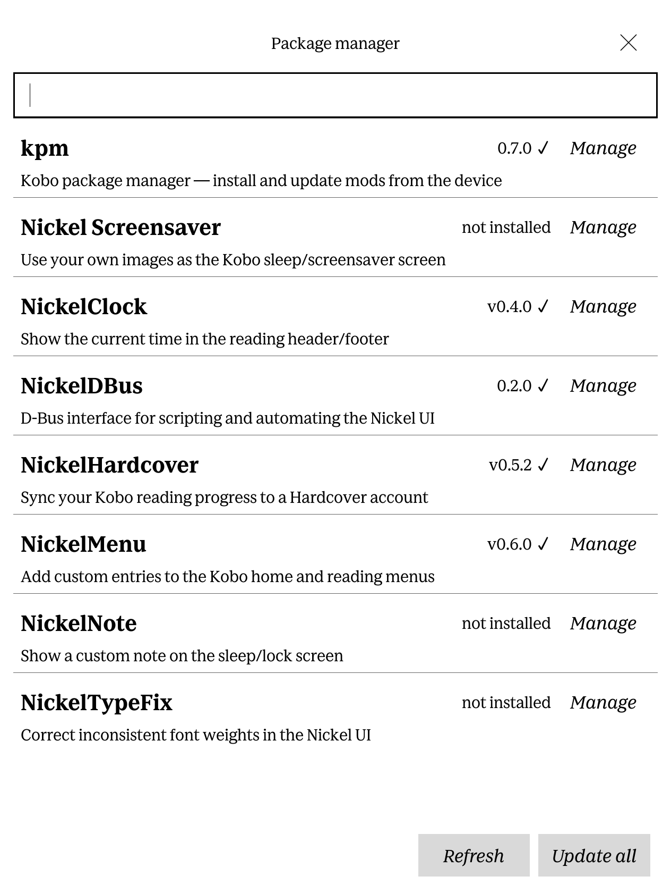
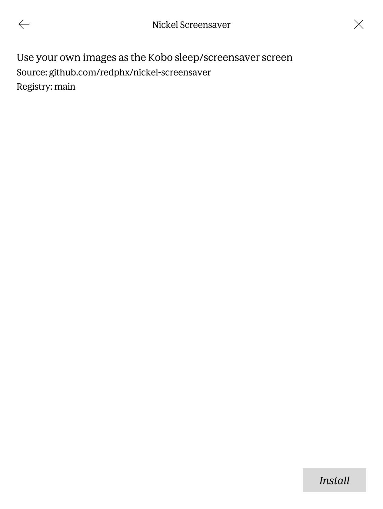
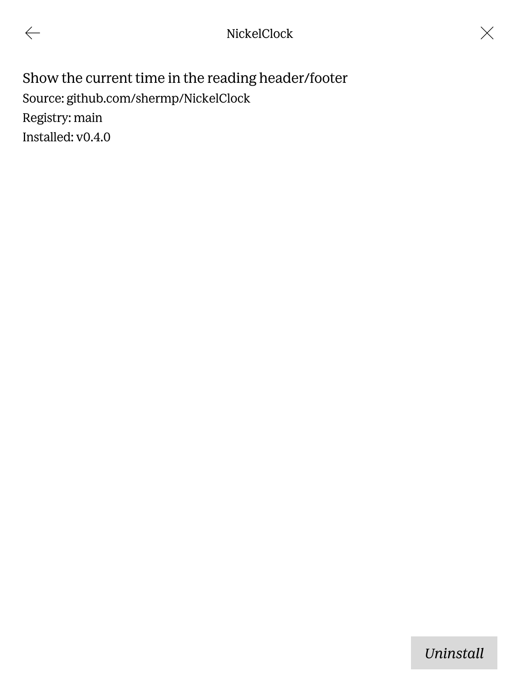

# kpm — Kobo Package Manager

A single static Go binary that manages third-party software on Kobo e-readers
(firmware 4.x). Packages are distributed as `KoboRoot.tgz` release assets on git
forges (GitHub, Codeberg, or any Gitea/Forgejo instance). kpm registers release
sources, checks for updates, stages installs into the firmware's single boot-time
install slot, pins versions, keeps a human-readable log, and updates itself the
same way. It is driven from NickelMenu on-device and works as a normal CLI over
telnet/SSH.

> Firmware 4.x only. No signature verification of assets — installing a package
> trusts its author, exactly like a manual `KoboRoot.tgz` install. Assets are
> fetched over TLS (HTTPS only; a redirect that downgrades to plain HTTP is
> refused) with an embedded Mozilla CA bundle. Archives are walked before
> staging: absolute/`..` paths, symlink/hardlink entries whose target escapes the
> archive, device/FIFO entries, and setuid/setgid files are rejected, and no
> package but kpm itself may write kpm's own install tree.

## How it works

Kobo's boot script extracts `/mnt/onboard/.kobo/KoboRoot.tgz` over the root
filesystem once per reboot, then deletes it. For most packages kpm never installs
files itself: it downloads each package's `KoboRoot.tgz`, **merges all pending
packages into one** staged archive, and reboots. On the next run it notices the
staged archive is gone and promotes those packages from *staged* to *installed*.

A few packages — KOReader and Plato — do not ship a `KoboRoot.tgz` at all. They
ship a plain directory tree in a release zip that lives entirely under
`/mnt/onboard/.adds/<name>/`. kpm extracts those itself, **immediately and with
no reboot**. See [App-tree installs](#app-tree-installs).

Everything kpm owns lives under `/mnt/onboard/.adds/kpm/` so you can inspect or
repair it over USB:

```
/mnt/onboard/.adds/kpm/
  bin/kpm              the static ARM binary
  packages.d/          one TOML file per registered package (kpm.toml = itself)
  state.json           installed/staged versions, manifests, last check
  kpm.log              append-only history
  status               last summary (shown by the NickelMenu Status dialog)
  cache/               package downloads (*.tgz/*.zip/*.part, swept selectively)
                       and registry caches (registry-<name>.toml, never swept)
/mnt/onboard/.adds/nm/kpm   NickelMenu drop-in
```

## Install

kpm is installed the same way it installs everything else: a `KoboRoot.tgz`
goes into the firmware's boot-time install slot and the next reboot installs
it. Grab the archive from the
[latest release](https://github.com/wolffshots/kpm/releases/latest) or build it
yourself:

```
go run ./build          # produces dist/kpm and dist/KoboRoot.tgz
```

Get it into the slot either way:

- **Over USB** — copy the archive into the hidden install slot, then eject;
  the Kobo reboots and installs it on boot:

  ```
  cp dist/KoboRoot.tgz /media/<you>/KOBOeReader/.kobo/KoboRoot.tgz
  ```

- **Over SSH** — if the device already has SSH access:

  ```
  scp dist/KoboRoot.tgz root@<kobo>:/mnt/onboard/.kobo/KoboRoot.tgz
  ssh root@<kobo> reboot
  ```

The binary installs to `/mnt/onboard/.adds/kpm/bin/kpm`, which is not on the
device's `PATH` — over SSH/telnet run it by full path or add it to your shell:

```
export PATH="$PATH:/mnt/onboard/.adds/kpm/bin"
```

[NickelMenu](https://github.com/pgaskin/NickelMenu) is **optional but
recommended**: with it kpm gets on-device menu entries (see "NickelMenu usage"),
including the launch point for the graphical UI (the UI needs NickelMenu — see
"Graphical UI"); without it kpm is a normal CLI over SSH/telnet. NickelDBus
(`qndb`) is also optional — if present, kpm shows toasts; if not, use the
**Status** menu entry. What to do next depends on which side you start from:

### Already running NickelMenu

kpm's menu entries appear after the install reboot. Register the mods you
already have so kpm *tracks* them instead of thinking they need a reinstall —
seed each one with the version currently on the device:

```
kpm registry add https://github.com/wolffshots/kobo-registry
kpm registry refresh
kpm install nickelmenu --installed v0.6.0 --yes    # the version you have
```

A hand-added `kpm add https://github.com/pgaskin/NickelMenu --installed v0.6.0`
works too, but the registry def also carries the curated uninstall recipe.

### No NickelMenu yet (SSH-first install)

kpm works headless, so use it to install NickelMenu:

```
kpm registry add https://github.com/wolffshots/kobo-registry
kpm registry refresh
kpm install nickelmenu --yes
kpm update nickelmenu --reboot
```

The reboot installs NickelMenu, and kpm's menu entries appear with it.

### Self-update

kpm ships `packages.d/kpm.toml` with an **empty `source`**, so self-update is
"not configured": `check`/`update` skip kpm silently and `list`/`status` show it
as `self-update not configured` — never an error. Adopt the registry's kpm def
to turn it on (after the `registry add`/`refresh` above):

```
kpm install kpm --adopt --yes
```

and kpm maintains itself like any other package. Since 0.9.1 there is a
shorthand for exactly this enrol — it refreshes the configured registries
(best-effort: a warm cache lets it enrol offline), finds the kpm def they offer,
and adopts it, preserving any pin:

```
kpm adopt-self
```

This is also the CLI command the graphical UI's **Enable self-update** button
calls (see *Graphical UI* below), so a device with no SSH can turn self-update on
from the touchscreen. It needs a configured registry that offers kpm and never
hardcodes a source.

Since 0.5.0 the adoption (`source`/`forge`) is stored in `state.json`, not in
`kpm.toml` — the same place kpm's pin lives, and for the same reason. Every kpm
release ships `packages.d/kpm.toml`, so a self-update overwrites that file; when
the adoption lived there, each self-update silently un-adopted kpm and it went
back to `self-update not configured`. Storing it in `state.json`, which updates
never overwrite, makes the adoption durable.

Upgrading from **0.4.1 or earlier**: if your kpm is still adopted (`status` does
not say `self-update not configured`), 0.5.0 migrates the source into
`state.json` automatically on its first mutating command. If a previous
self-update already wiped it, re-adopt **once** under 0.5.0 and it sticks for
good:

```
kpm registry refresh && kpm install kpm --adopt --yes
```

kpm's own recorded version self-heals from the running binary, so a
USB-sideloaded kpm corrects its `installed_version` on the next mutating command.

## Registering packages

`kpm add <url>` writes a `packages.d/<id>.toml`. It accepts a repo URL, with an
optional trailing `/releases`, `/releases/latest`, or `/releases/tag/<tag>` (a
`/tag/<tag>` URL pins that tag):

```
kpm add https://codeberg.org/StrayRose/NickelHardcover
kpm add https://github.com/owner/repo --asset "KoboRoot*.tgz"
kpm add https://codeberg.org/o/r/releases/tag/v0.5.0     # pinned
```

- Forge is auto-detected: `github.com` → GitHub; any other host is probed at
  `https://<host>/api/v1/version` (Forgejo/Gitea). If detection fails, pass
  `--forge github|forgejo`.
- Default asset is `KoboRoot.tgz`; override with `--asset <glob>`.
- For a package you installed **before** kpm, seed its version so kpm won't think
  a reinstall is needed: `kpm add <url> --installed v0.5.0`.

A package TOML looks like:

```toml
name = "NickelHardcover"
source = "codeberg.org/StrayRose/NickelHardcover"
forge = "forgejo"
asset = "KoboRoot.tgz"
pin = ""                # empty = track latest; else an exact tag (frozen: even a
                        # rolling package is not re-fetched while a pin is set)

# [uninstall]           # optional — customizes "kpm uninstall" (see below)
# purge_paths = ["/mnt/onboard/.adds/NickelHardcover/**"]
```

(kpm's own pin is stored in `state.json`, not `kpm.toml`, so it survives a
self-update that overwrites the TOML.)

## Registries

Instead of adding each package by URL, you can trust a **registry**: a git repo
that ships package definitions (the same TOML schema as `packages.d`, plus
curated `[uninstall]` recipes). kpm fetches its `registry.toml` over raw-file
HTTPS — no git client, no clone. A registry holds *definitions only*, never
binaries; the actual software still comes from each package's own release page.

A public registry of common Kobo mods lives at
[wolffshots/kobo-registry](https://github.com/wolffshots/kobo-registry) —
**browse its packages at
[wolffshots.github.io/kobo-registry](https://wolffshots.github.io/kobo-registry/)**.

Trusting a registry is the same trust decision as running `kpm add` on each of
its entries yourself: a def chooses the source repo and the uninstall recipe
(including `run_before`/`run_after` hooks, which run as root). There is **no def
signing** in this version, just as there is no asset signing — TLS with the
embedded CA bundle protects the fetch, not the maintainer's intent.

**Checksum verification narrows that gap; it does not close it.** From 0.10.0 a
registry entry may carry a per-release `sha256` (see below), which kpm verifies
against the downloaded bytes and hard-fails on a mismatch. It raises the bar
against a compromised CDN or a silent upstream re-upload, but it is a *curator
attestation* rather than a signature: it authenticates the asset against a
registry you already chose to trust, it is opt-in per release, and it is
best-effort across kpm versions — an older kpm ignores the field and downloads
with TLS-only verification, so it binds nobody who has not updated.

**A registry repo** has one file at its root, `registry.toml`:

```toml
schema_version = 1

[packages.nickelmenu]
name   = "NickelMenu"
source = "github.com/pgaskin/NickelMenu"
forge  = "github"
asset  = "KoboRoot.tgz"
min_kpm = "0.3.0"                 # optional; older kpm skips it with a note

  [packages.nickelmenu.uninstall]
  method       = "marker"
  marker_file  = "/mnt/onboard/.adds/nm/uninstall"
  needs_reboot = true
```

Package ids follow the `[a-z0-9-]+` rule. Fields match the local schema except
there is **no `pin`** (pins are a local decision, never distributed) and the
optional `min_kpm`. `schema_version` must be `1`; a newer schema tells you to
update kpm.

**Three optional fields change what install/update actually do** (0.10.0). Unlike
`description`/`homepage`/`tested_fw`, they are functional: they are copied into
your local `packages.d` def and a curator edit to them propagates via `kpm sync`.
A def whose declarations are malformed is dropped from the registry entirely, so
a typo makes the package disappear rather than misbehave — kpm logs a `WARN`
naming the id and the reason on every refresh and every cache read, so a
vanished package is diagnosable from `kpm log`.

| Field | What it does | `min_kpm = "0.10.0"` required? |
|---|---|---|
| `update_check = "rolling"` | detect a changed release when the tag never moves | **yes** |
| `conflicts = ["<id>", …]` | refuse to install alongside a named package | **yes** |
| `checksums` (tag → sha256) | verify the downloaded asset against a curator-recorded hash | no |

```toml
# KoboCloud publishes every build under the permanent tag "latest", so comparing
# tags can never detect an update. "rolling" compares the release's published_at
# and asset size instead. min_kpm is mandatory: an older kpm ignores the key and
# would report this package up to date forever.
[packages.kobocloud]
name         = "KoboCloud"
source       = "github.com/fsantini/KoboCloud"
forge        = "github"
asset        = "KoboRoot.tgz"
update_check = "rolling"
min_kpm      = "0.10.0"

# kobo-tweaks auto-uninstalls NickelClock as part of its own install, which would
# delete a kpm-tracked package's files behind kpm's back. min_kpm is mandatory:
# an older kpm ignores `conflicts` and would let that happen.
[packages.kobo-tweaks]
name      = "Kobo Tweaks"
source    = "github.com/…/kobo-tweaks"
forge     = "github"
asset     = "KoboRoot.tgz"
conflicts = ["nickelclock"]
min_kpm   = "0.10.0"

# A checksum is a per-release curator attestation, keyed by the exact upstream
# tag (a single leading "v" is insignificant). Releases you have not verified are
# simply absent — they install unverified, exactly as before.
[packages.nickelclock.checksums]
"v0.4.0" = "3b1f8c…64 lowercase hex chars…"
```

Curator notes:

- `conflicts` is declared **once**, on whichever side is natural. kpm checks both
  directions, so the counterpart entry needs no edit.
- Get a hash with `curl -sL <browser_download_url> | sha256sum`, or read it out
  of `kpm log` — every successful download logs a `CHECKSUM` line with the hash
  it saw, whether or not a checksum was declared. Hash the asset **exactly as
  published** (for a zip-wrapped asset, the zip — not the tgz inside it).
  GitHub also shows a `sha256:`-prefixed digest on recent asset uploads; you can
  paste that verbatim — the prefix and any surrounding whitespace are stripped.
- Never put a `checksums` block on a `rolling` def: a rolling tag's asset changes
  with no registry edit, so the hash would be correct exactly once. kpm treats
  the combination as a parse error and drops the def. (A *local* def hand-edited
  to carry both degrades to unverified with a `WARN` instead, so a bad edit can
  never make a package permanently un-installable.)
- `update_check = "rolling"` without `min_kpm` is also a parse error and drops
  the def. An older kpm ignores the key and would report the package up to date
  forever, which is the exact failure the field exists to fix.

**Using registries** (CLI/telnet — there is no NickelMenu entry for these):

```
kpm registry add https://github.com/owner/kobo-registry --name main
kpm registry refresh                # the only registry command that hits the network
                                    #   (registry add also runs a one-time forge probe unless --forge is given)
kpm search                          # what's available (marks installed / updatable / min_kpm)
kpm search nickel                   # filter by id or name
kpm install nickelmenu              # prints the def and exits 3 (review first)
kpm install nickelmenu --yes        # writes packages.d/nickelmenu.toml, stamped registry = "main"
kpm check && kpm update nickelmenu  # then it behaves exactly like a hand-added package
```

Key behaviors:

- **Network only in `registry refresh`** (plus an optional one-time
  forge-detection probe during `registry add`, skipped with `--forge`).
  `search`/`install`/`sync` read the on-device cache
  (`cache/registry-<name>.toml`) exclusively, so they work offline and are
  predictable. `search`/`registry list` show a cache-age note
  (`cached 3d ago`) instead of silently refetching. Refresh uses ETags, so an
  unchanged registry is a cheap 304.
- **Provenance & `sync`.** An installed def is stamped `registry = "<name>"`.
  When a registry publishes a fixed uninstall recipe or changed asset glob,
  `kpm sync` re-copies every field *except* your local `pin` and reports a
  per-package diff. `sync` is deliberately manual — `check`/`update` never
  change install/uninstall behavior underneath you. If you hand-edit a
  registry-managed def, `sync` detects the drift and skips it (use
  `--overwrite` to replace, or delete the `registry =` line to detach). If a
  package disappears from its registry, `sync` warns but leaves your working
  copy intact.
- **Conflicts.** If several registries offer the same id, the earliest in
  config order wins; the rest are shadowed (a `WARN` is logged once per
  refresh).
- **`--adopt`.** `kpm install <id> --adopt` takes over an existing hand-added
  def (or kpm's own placeholder), writing the registry def while preserving your
  local pin and installed state — how kpm's own def gets a real source once a
  registry carries it.
- **Firmware note.** If a registry def declares `tested_fw` (the newest firmware
  it was confirmed working on) and your device is running a newer firmware, the
  `kpm install` review prints an advisory note (`last confirmed on firmware …;
  your device runs … — it may not work`). It is advisory only — it never blocks
  the install or changes the exit code, the comparison is major.minor (a build
  bump alone never warns), and an unknown firmware stays silent.

Registries are configured in `/mnt/onboard/.adds/kpm/config.toml`
(`[[registries]]` entries), managed by the CLI and hand-editable; unknown keys
(and a future `github_token`) are preserved across edits, though comments are
not.

## NickelMenu usage

The shipped drop-in (`/mnt/onboard/.adds/nm/kpm`) adds four entries to the main
menu:

- **Check for updates** — brings Wi-Fi up, runs `kpm check --notify` in the
  background. With NickelDBus you get a toast; otherwise tap **Status**.
- **Update all** — brings Wi-Fi up, runs `kpm update --all --reboot --notify`.
  This stages every pending package and reboots to install them.
- **Status** — shows the status file in a dialog (offline, instant).
- **Package manager** — runs `kpm ui`, which opens the graphical browser (see
  "Graphical UI"). This is the launch point for the NickelKPM hook.

Because NickelMenu's `cmd_spawn` reports success on *spawn*, not on completion,
long-running work can't report back through the menu — kpm signals completion via
its status file (always) and NickelDBus toasts (if `qndb` exists).

## Graphical UI (NickelKPM)

kpm ships a built-in graphical package browser, **NickelKPM** (`libnkpm.so`) — a
NickelHook Qt mod injected into Nickel. Every kpm KoboRoot.tgz installs it under
`/usr/local/Kobo/imageformats/libnkpm.so`.

| Package list | Not installed | Installed |
|---|---|---|
|  |  |  |

Launch it from the **NickelMenu** "kpm - Package manager" entry (see "NickelMenu
usage"). It opens a full-screen browser that lists every package from your
registries merged with what's installed, lets you filter with the on-screen
keyboard, and drills into a per-package view with **Install**, **Update**,
**Uninstall**, plus registry-wide **Refresh**, **Sync**, and **Update all**.
**Sync** re-copies registry defs into `packages.d` so an existing install picks
up new config declarations and uninstall-recipe fixes without SSH — the offline
UI equivalent of `kpm sync` (distinct from **Refresh**, which only refetches the
registry list and re-checks versions). When self-update is not yet enrolled the
kpm row shows a **self-update off** badge and its detail page carries an **Enable
self-update** button; one tap runs `kpm adopt-self` (kpm 0.9.1) to wire kpm's own
source in from your configured registry, then offers to check for an update — so
a device with no SSH can turn self-update on from the touchscreen. On the package
list the title-bar **✕** closes the UI; in a package's detail view the **←**
returns to the list and **✕** closes the whole UI. All real work is done by
shelling out to the `kpm` binary (`--json` mode); the hook is a thin,
crash-isolated view layer. Staged changes prompt a **Reboot now / Later** dialog,
matching kpm's stage-then-reboot install model.

Above the search box the browse view carries three tabs: **Mods**, **Fonts**,
and **Dictionaries**. A package lands in a tab by where it installs: KOReader,
Plato, and kpm itself show under Mods, and a package that installs into
`/mnt/onboard/fonts` shows under Fonts. Refresh, Sync, and Update all stay
global across every tab, and the search box filters inside whichever tab is
active. The Dictionaries tab carries a work-in-progress note, matching the
note in [Fonts](#fonts).

Installed packages whose registry entry declares config files (CONFIG.md) also
get a **Settings** button: it lists the package's config files, shows their
entries (ini keys or text lines), and edits values with the on-screen keyboard —
each save is a surgical write through `kpm config set`, so comments and layout
in the file survive untouched. Files marked `reload = "reboot"` prompt for a
restart on the way out; others take effect on their own.

While the browser is open it hides the home screen's status and nav bars so the
dialog (and its keyboard) render full-screen, and restores them when you close
it — so the launcher is a NickelMenu entry rather than an injected home-screen
row (see below).

If the `kpm` binary is missing, the browser shows a "kpm not found — install kpm
first" message and does nothing else (it never crashes Nickel).

**Requires NickelMenu.** Through kpm 0.6.x the hook injected its own row into the
home/library **More** tab. Firmware **4.23.15505+** moved that menu to a
bottom-nav-bar button, so the old anchor no longer fires (confirmed dead on
4.45.23697), and since **0.7.0** the UI is launched from a NickelMenu item that
runs `kpm ui`. A NickelMenu-independent launch button is a possible future
addition, but for now the graphical UI needs NickelMenu installed.

**Symbol compatibility (fail-closed):** at load the hook resolves every Nickel
C++ symbol it needs; if any required symbol is missing it refuses to load
cleanly — Nickel runs untouched and a diagnostic log is dumped to
`/mnt/onboard`. Verified to load on firmware **4.45.23697** (and back to
4.33.19608); **4.20.14601 and older fail this check** (Nickel's method signatures
drifted), so on those the UI is absent by design. Check any firmware from your
desk with `tools/symcheck` (see "Build & release"). A crash inside the first
15 seconds after load trips NickelHook's failsafe, which leaves the hook
disabled on the next boot instead of bootlooping.

**Removing the UI only:** create the flag file `/mnt/onboard/kpm_ui_uninstall`
and reboot. NickelHook deletes `libnkpm.so` on the next boot; kpm itself (binary,
config, state, packages) is untouched. (Firmware is out of scope past 4.x, same
as NickelHardcover.)

### Building the hook

The hook is C++ built with the NickelTC cross-toolchain via a container. From the
repo root:

```sh
git submodule update --init --recursive          # fetch hook/NickelHook (once)
podman run --rm -v "$PWD":"$PWD" -w "$PWD/hook" ghcr.io/pgaskin/nickeltc:1.0 make
```

That produces `hook/libnkpm.so`. `go run ./build` then bundles it into
`dist/KoboRoot.tgz` (it fails with a clear message if the `.so` is absent; point
`KPM_UI_SO` at a prebuilt library to override the path). On Windows the volume
mount is `-v "C:/…/kpm:/work" -w /work/hook` (set `MSYS_NO_PATHCONV=1` under Git
Bash).

## CLI reference

```
kpm add <url> [--asset <glob>] [--forge github|forgejo] [--name <id>] [--installed <ver>]
                            register a package from a forge release URL
kpm remove <id>             unregister only (deletes the TOML; files stay — see uninstall)
kpm uninstall <id> [--purge] [--dry-run] [--yes] [--force] [--keep-registration] [--reboot] [--notify]
                            delete a package's installed files (see "Uninstalling")
kpm list [--json]           offline table: id, installed, staged, latest, pin
kpm check [--notify]        query forges for all packages; update state + status file
kpm update [<id>...] [--all] [--reboot] [--notify]
                            download, verify, merge and stage updates; reboot to install
                            (after a reboot promotes a staged install, kpm existence-checks
                            the package's manifest and logs a WARN naming any files that
                            never landed; the missing state shows in search/status --json
                            and self-clears once the files reappear)
kpm unstage                 cancel a pending staging (remove the kpm-staged tgz, clear staged state)
kpm pin <id> <tag>          pin to an exact tag (downgrade allowed)
kpm unpin <id>              track latest again
kpm registry add <url> [--name <n>] [--ref <branch>] [--path <p>] [--forge github|forgejo]
                            trust a registry of package definitions (see "Registries")
kpm registry remove <name>  forget a registry and its cache (installed packages unaffected)
kpm registry list           name, url, ref, cache age, package count
kpm registry refresh [<name>]  refetch registry.toml (all by default; the only registry
                            network call besides registry add's one-time forge probe)
kpm search [<term>]         list/filter packages across cached registries
kpm doctor [<id>]           diagnose whether installed Nickel plugins actually loaded
                            (read-only; no lock, no network — see below)
kpm install <id> [--pin <tag>] [--installed <ver>] [--yes] [--adopt]
                            copy a package def from a registry into packages.d
kpm adopt-self [--json]     enrol kpm's own self-update from a configured registry
                            (best-effort refresh + install kpm --adopt in one step)
kpm sync [<id>...] [--overwrite]  re-copy registry defs for registry-managed packages
kpm config list <id>        declared config files for a package (offline)
kpm config show <id> <file> entries of one config file — ini keys or text lines
                            (<file> = declared name, case-insensitive, or 1-based index)
kpm config set <id> <file> (--key K [--section S] | --line N [--append|--delete]) --value V
                            edit one entry; surgical write, comments/layout preserved
kpm config init <id> <file> [--force]  create a missing config file from the example
                            template its registry entry ships (refuses to overwrite)
kpm log [-n N]              print the last N log lines (default 12)
kpm status                  print the status summary + any pending staging; fast/offline
kpm ui                      signal the NickelKPM hook to open the graphical browser
kpm version                 print the compiled-in version
```

Exit codes: `0` ok / nothing to do, `1` error, `2` partial (some packages failed
but others still staged), `3` confirmation required (`uninstall`/`install`
without `--yes`).
If every selected `update` package fails and nothing stages, the exit is `1`.

**Machine-readable output:** `status`, `list`, `search`, `check`, `install`,
`update`, `uninstall`, `sync`, `unstage`, `registry list`, `registry refresh`,
`config list`, `config show`, `config set`, `config init`, `doctor`, and
`version` accept `--json`. Human/progress output streams as usual; the final
stdout line is the marker `BEGIN_JSON` immediately followed by one compact JSON
object. This is what the graphical UI consumes; it also serves scripts.

`doctor` answers a question `status` cannot: an "installed / up to date" package
may still do nothing. It checks each installed NickelHook plugin for a failsafe
quarantine sibling, a fresh NickelHook crash dump-log, and whether the plugin is
actually mapped into the running Nickel, reporting `loaded` / `not-loaded` /
`crashed` / `load-failed` / `unknown`. This is how kpm can now explain cases like
NickelNote installing cleanly on firmware 4.45 yet never rendering. It reads only
files and `/proc` — no lock, no network — and a bad verdict is never a command
failure (exit stays 0). A `loaded` verdict proves the plugin mapped in, not that
the mod works; a hook that silently no-ops leaves no trace, so `tools/symcheck` is
the static pre-install complement. See DOCTOR.md.

`update` merges all pending packages into one staged `KoboRoot.tgz` (kpm's own
entries are merged last so nothing can clobber the new binary). Re-running
`update` before a reboot re-merges the already-staged packages so none are lost.
A download or verification failure skips only that package. kpm refuses to
overwrite a `KoboRoot.tgz` it didn't stage (verified by content hash), so a
manual install is never clobbered — and `kpm unstage` cancels a pending staging
(it removes the tgz only if kpm staged it, then clears the staged state).

Only one mutating kpm command runs at a time: it takes a lock at
`.adds/kpm/lock`, and a second mutating command fails with "another kpm instance
is running" (a lock older than 10 minutes is assumed stale and broken).
Read-only commands (`list`/`status`/`log`/`version`/`search`/`doctor`/
`registry list`/`config list`/`config show`)
don't take the lock and never write state.

`KPM_ROOT` overrides the `/mnt/onboard` root (used by tests and for dev runs off
the device). `KPM_SYSROOT` overrides the rootfs `/` so `uninstall` deletions land
inside a sandbox during tests.

## App-tree installs

Most packages install by staging a `KoboRoot.tgz` for the firmware to unpack on
the next reboot. **KOReader** and **Plato** do not: their releases are a plain
directory tree in a zip that lives under `/mnt/onboard/.adds/<name>/`, with no
root files and nothing for the firmware to do. kpm extracts those itself.

The practical differences:

| | tgz packages | app-tree packages |
|---|---|---|
| When it takes effect | after a reboot | immediately, except a font package (see [Fonts](#fonts)) |
| `kpm update` reports | `staged — reboot to install` | `installed` |
| `--reboot` | reboots | does nothing, except for a font package |
| `kpm uninstall` | removes files on the next reboot | removes them now |
| `install_method` in `--json` | `"tgz"` | `"app-tree"` |
| `kind` in `--json` | `"mod"` | `"mod"`, or `"font"` for a package installed into `/mnt/onboard/fonts` |

A def opts in with an `[install]` table:

```toml
[packages.koreader.install]
method = "app-tree"
root   = "koreader"                       # the prefix inside the zip to extract
dest   = "/mnt/onboard/.adds/koreader"    # where its contents land

  [packages.koreader.install.launcher]    # optional NickelMenu entry
  nm_file  = "/mnt/onboard/.adds/nm/koreader"
  nm_entry = "menu_item:main:KOReader:cmd_spawn:quiet:exec /mnt/onboard/.adds/koreader/koreader.sh"
```

`dest` must be inside kpm's writable allowlist (`.adds`/`.kobo` on the user
partition, `/usr/local`, `/opt` on the rootfs) and must be a package-specific
directory, never a shared root like `.adds` itself. A content directory such
as `/mnt/onboard/fonts` is the one exception: every font package shares it,
under the per-file ownership rule in [Fonts](#fonts). Every entry in the zip is
validated **before a single byte is written**: absolute paths, `..` traversal,
backslashes, control characters, symlinks, device nodes and setuid entries are all
refused, and each destination is re-checked against the same path policy
`kpm uninstall` uses immediately before the write that uses it. Any violation
fails the whole install — a half-extracted app is worse than none.

Because most of these packages install as soon as `kpm update` finishes, a run
that only updates app-tree packages needs no reboot, and the "Update all"
NickelMenu entry completes without one. A font package is the exception:
Nickel does not use a new or replaced font until the next reboot, so a
font-only run still asks for one. See [Fonts](#fonts).

### What survives an update

**kpm deletes only files it previously installed.** Everything else inside
`.adds/koreader` — your settings, statistics, annotations, downloaded plugins,
Plato's `Settings.toml` and `dictionaries/` — is user data by definition and is
never touched. kpm knows exactly what it installed because it records a manifest
every time, so this needs no configuration and cannot be got wrong by a curator.

A plain `kpm uninstall koreader` therefore removes the app and leaves your data;
`--purge` removes the whole directory.

### Launching them

kpm writes the NickelMenu entry the def declares, and **never overwrites one that
already exists** — if you have customised your entry, it is left alone and kpm
says so. `kpm update <id> --force-launcher` rewrites it.

If NickelMenu is not installed, kpm writes the drop-in anyway (it is inert until
NickelMenu arrives) and warns:

```
koreader: NickelMenu not detected — install it ("kpm install nickelmenu") to get a launch entry
```

If you use **KFMon** instead, its shipped config already points at
`/mnt/onboard/.adds/koreader/koreader.sh` and `/mnt/onboard/.adds/plato/plato.sh`,
so a kpm install/update keeps working. The one thing kpm cannot do is place the
launcher *icon*: KFMon watches `/mnt/onboard/koreader.png` and
`/mnt/onboard/icons/plato.png`, which sit at the root of the user partition —
outside kpm's writable allowlist. Copy them from the release zip over USB.
`kpm doctor` tells you if that step is missing.

### Firmware 4.17+ and your library

From firmware 4.17 Nickel indexes files inside hidden folders, so an app tree
under `.adds/` can show up as junk "books" in your library. The fix is one line in
`/mnt/onboard/.kobo/Kobo/Kobo eReader.conf`:

```
[FeatureSettings]
ExcludeSyncFolders=(\\.(?!kobo|adobe).+|([^.][^/]*/)+\\..+)
```

**kpm deliberately does not make this edit.** Nickel owns that file, rewrites it,
and reverts changes made while it is running — and kpm's own UI runs *inside*
Nickel, so an edit from there would often appear to work and then silently revert.
Edit it over USB with the Kobo idle. `kpm doctor` detects whether the line is
present and prints exactly what to add if it is not.

### Firmware 5.x

KOReader publishes a separate `koreader-kobov5-*.zip` for firmware 5.x. The
registry entry tracks the 4.x build; on a firmware 5 device kpm shows the
"untested on your firmware" note at install time. The failure mode if you ignore
it is an app that does not start — not a brick, and uninstall still works.

### Fonts

Font packages use the same app-tree method as KOReader and Plato. The install
destination is always `/mnt/onboard/fonts`, and it is flat: kpm refuses a font
zip that carries a subfolder, because Nickel reads only the files directly
inside `fonts`, not anything nested under it.

```toml
[packages.kf-core-fonts.install]
method = "app-tree"
dest   = "/mnt/onboard/fonts"
```

**Reboot to use a new or replaced font.** Installing or updating a font
package writes its files right away, but Nickel does not use a new or
replaced font until the next reboot. kpm's own reboot prompt covers this: the
same **Reboot now / Later** dialog appears for a font install, update, or
uninstall.

**Ownership.** `/mnt/onboard/fonts` is a directory every font package shares,
so kpm applies a per-file rule in place of the usual one-package-per-directory
rule: kpm never overwrites a font it did not install. If you already copied a
font into that folder by hand, move it off the device before kpm installs a
package that ships the same filename.

**Uninstall removes only what kpm installed.** A font package's uninstall
deletes the files recorded in its own manifest, and nothing else. Your own
fonts, and the `fonts` folder itself, survive an install, update, or uninstall
of any font package kpm manages.

Two limits are worth knowing, and neither happens with an ordinary font package.
A tgz package can ship a file into the fonts folder. Nickel unpacks that file at
boot, so kpm never runs the ownership check, and a shipped font that uses your
filename replaces yours. A package definition can also name one file in the
fonts folder in its `extra_paths`, and kpm then deletes that file at uninstall.

**Dictionaries are a work in progress.** The graphical UI's Dictionaries tab
exists today and explains this. No install path is built yet, and this
README names no target date.

**Older kpm and font packages.** kpm 0.11.0 and earlier reject a font package
definition when they load the registry, because `/mnt/onboard/fonts` was not
yet a writable destination for those versions. Each rejected def is named in
one line, with the reason "not within a writable location". This is
cosmetic: the def is safely dropped, and the line stops appearing once the
device's kpm updates to 0.12.0 or later.

## Uninstalling packages

`kpm remove <id>` only unregisters a package (deletes its TOML); the installed
files stay. To delete the files, use `kpm uninstall <id>`.

Uninstall is destructive and kpm runs non-interactively, so it never prompts:
it prints a **plan** and, without `--yes`, exits `3` so you can review first.

```
kpm uninstall nickelhardcover              # prints the plan, exits 3
kpm uninstall nickelhardcover --dry-run    # prints the plan, changes nothing, exits 0
kpm uninstall nickelhardcover --yes        # applies it
kpm uninstall nickelhardcover --yes --purge   # also removes user data (purge_paths)
```

On success kpm clears the package from `state.json` and deletes its
`packages.d/<id>.toml` (keep it with `--keep-registration`). `--reboot` reboots
afterwards; some packages need a reboot to finish (see the marker method).

**Path safety.** Every deletion candidate — whether from the recorded manifest,
`extra_paths`, or `purge_paths` — is checked against a policy:

- A **hard denylist** is always refused, even via `allow_paths`: `/bin`, `/sbin`,
  `/lib`, `/drivers`, `/dev`, `/proc`, `/sys`, `/root`, `/var`; all of `/etc`
  **except** `/etc/udev/rules.d` and `/etc/dbus-1` (so `/etc/passwd`, `/etc/shadow`,
  `/etc/inittab`, `/etc/init.d`, `/etc/fstab`, … can never be deleted); all of
  `/usr/local/Kobo` **except** `/usr/local/Kobo/imageformats` (where NickelHook
  mods like `libnm.so` live); everything at/under `/mnt/onboard` **except**
  `/mnt/onboard/.adds`, `/mnt/onboard/.kobo`, and `/mnt/onboard/fonts` (so the
  book library is protected, and a purge of the whole `fonts` folder at once is
  still refused, see [Fonts](#fonts));
  plus kpm's own `bin`, `state.json`, and `kpm.log`.
- An **allowlist** is deletable: `/mnt/onboard/.adds`, `/mnt/onboard/.kobo`,
  `/usr/local`, `/usr/bin`, `/usr/lib`, `/opt`, `/etc/udev/rules.d`, `/etc/dbus-1`.
  Because the denylist is checked first, `allow_paths` can extend the allowlist to
  new locations (e.g. `/srv/...`) but never re-enable any denied path above.
- Per-package `allow_paths` extends the allowlist but can never override the
  denylist.
- Anything else is **skipped with a WARN** and the rest of the removal continues.

Symlinks are never followed (the link itself is removed); shared directories
survive because kpm only `rmdir`s directories that end up empty. `--force` only
bypasses a failing `run_before`, never the path policy.

### The `[uninstall]` table

Every field is optional. A bad `[uninstall]` block only errors when `uninstall`
runs — it never breaks `add`/`check`/`update`. And a package file that is
entirely unreadable (malformed TOML, or a filename that isn't a valid id) is
skipped with a warning in the log rather than making every package invisible;
that one package simply doesn't exist until you fix the file.

One exception: a file with **malformed TOML** blocks `kpm install` and
`kpm update` with a message naming it, because kpm cannot see what conflicts that
package declares and will not answer the question from a partial view. Fix the
file or `kpm remove` it. A file whose *filename* isn't a valid id is only warned
about — it was never registered, so it cannot declare anything.

(`kpm pin`/`unpin` rewrite the package's TOML, preserving unknown fields but
**not comments** — a TOML-library limitation.)

```toml
[uninstall]
method       = "manifest"   # "manifest" (default) | "marker" | "marker-remove"
extra_paths  = []           # extra software artifacts to always delete
purge_paths  = []           # user data/config; deleted ONLY with --purge
keep_paths   = []           # protect these (subtracted from the deletion set)
allow_paths  = []           # extend the deletable-path allowlist (never the denylist)
marker_file  = ""           # marker: file to create; marker-remove: file to delete (required for both)
needs_reboot = false        # defaults to true for marker/marker-remove, false otherwise
run_before   = ""           # /bin/sh -c before removal; nonzero aborts (unless --force)
run_after    = ""           # /bin/sh -c after removal; nonzero is logged, not fatal
```

Configured paths are absolute device paths. Entries in `extra_paths`,
`purge_paths`, and `keep_paths` may end in `/**` to mean "this directory,
recursively". `run_before`/`run_after` run as root, exactly like the package's
own install already did.

**Manifest method** (the default) deletes exactly what the package installed —
the manifest kpm captured when it staged the package — plus `extra_paths`, minus
`keep_paths`. Example, NickelHardcover, also wiping its data with `--purge`:

```toml
# packages.d/nickelhardcover.toml
name = "NickelHardcover"
source = "codeberg.org/StrayRose/NickelHardcover"
forge = "forgejo"
asset = "KoboRoot.tgz"

[uninstall]
purge_paths = ["/mnt/onboard/.adds/NickelHardcover/**"]
```

```
kpm uninstall nickelhardcover --yes --purge   # removes files AND the data dir
```

If a package predates kpm it has no manifest; set `extra_paths` (or update it
through kpm once) or uninstall refuses.

**Marker method** is for packages with their own removal mechanism, like
NickelMenu: instead of deleting files out from under a running Nickel, kpm
creates the file NickelMenu watches for and reboots. NickelMenu removes itself
on the next boot:

```toml
# packages.d/nickelmenu.toml
name = "NickelMenu"
source = "github.com/pgaskin/NickelMenu"
forge = "github"
asset = "KoboRoot.tgz"

[uninstall]
method       = "marker"
marker_file  = "/mnt/onboard/.adds/nm/uninstall"
needs_reboot = true
```

```
kpm uninstall nickelmenu --yes --reboot   # writes the marker, reboots to finish
```

`extra_paths`/`purge_paths`/`keep_paths` still apply for the marker method (e.g.
purge NickelMenu's config dir alongside the marker with `--purge`).

**Marker-remove method** is the inverse convention used by NickelHook mods like
NickelClock, NickelDBus, and NickelTypeFix: the package *ships* a trigger file
whose *absence* makes it remove itself on the next boot. kpm deletes that file
and reboots — deleting the mod's files directly would rip a loaded `.so` out
from under Nickel instead of following the package's supported path:

```toml
# packages.d/nickelclock.toml
name = "NickelClock"
source = "github.com/shermp/NickelClock"
forge = "github"
asset = "NickelClock-*.zip"

[uninstall]
method      = "marker-remove"
marker_file = "/mnt/onboard/.adds/nickelclock/uninstall"
purge_paths = ["/mnt/onboard/.adds/nickelclock/**"]
```

```
kpm uninstall nickelclock --yes --reboot   # deletes the trigger, reboots to finish
```

If the trigger file is already absent (the package is already uninstalling, or
was removed by hand), the uninstall succeeds as a no-op — the reboot note still
applies. A *directory* at the marker path is an error. The other fields compose
exactly as for `marker` (e.g. `--purge` removes the config dir alongside the
trigger delete).

There is no NickelMenu entry for uninstall — it stays CLI-only (telnet/SSH) on
purpose: a one-tap destructive action is a footgun.

### Removing kpm itself

`kpm uninstall kpm` is refused. Remove kpm by hand over USB: delete
`/mnt/onboard/.adds/kpm` (its binary, state, log, and registrations) and
`/mnt/onboard/.adds/nm/kpm` (its NickelMenu drop-in), then reboot.

## First install & smoke test (telnet)

After the bootstrap reboot, connect over telnet/SSH (as root) and confirm:

```
# kpm version
0.9.2

# kpm add https://codeberg.org/StrayRose/NickelHardcover
registered nickelhardcover -> codeberg.org/StrayRose/NickelHardcover [forgejo], asset "KoboRoot.tgz"

# kpm check
kpm 0.9.2 — checked 2026-07-19 10:30
nickelhardcover  - -> v0.5.1  UPDATE AVAILABLE
kpm              0.9.2        self-update not configured
1 update available. Use "Update all" to install (reboots).

# kpm update --all           # stage without rebooting
1 package(s) staged — reboot to install

# kpm log
2026-07-19 10:30:00  CHECK      nickelhardcover  - -> v0.5.1 available
2026-07-19 10:31:02  STAGE      nickelhardcover  - -> v0.5.1

# reboot                     # firmware installs the staged tgz on boot
# kpm check                  # after reboot, the next mutating command promotes
                             #   staged -> installed (status is read-only and shows
                             #   the result; it does not itself promote)
```

Inspect `/mnt/onboard/.adds/kpm/kpm.log` at any time for the full history.

## Troubleshooting

- **A staged update you want to cancel.** Run `kpm unstage` (before rebooting).
  It removes the staged `KoboRoot.tgz` only if kpm staged it and clears the
  staged state. Deleting `.kobo/KoboRoot.tgz` by hand instead desyncs kpm (it
  will still promote the packages it thought it staged), so prefer `unstage`.
- **Corrupt `state.json`.** If the state file ever becomes unreadable, kpm
  renames it to `state.json.corrupt-<timestamp>`, logs a `WARN`, and starts from
  empty state rather than failing every command. (If it can neither rename nor
  copy the corrupt file aside, it errors instead of overwriting the only copy.)
  Re-seed installed versions with `kpm add <url> --installed <ver>`; kpm's own
  version re-seeds automatically. If an update was staged but not yet installed
  when the corruption happened, its `.kobo/KoboRoot.tgz` becomes "foreign"
  afterward — reboot to install it, or delete that file by hand.
- **"conflicts with installed package".** A package whose registry def declares a
  `conflicts` entry is refused while the named package is still on the device,
  because installing it would delete that package's files behind kpm's back:

  ```
  kpm install: "kobo-tweaks" conflicts with installed package "nickelclock" — uninstall it first: kpm uninstall nickelclock
  ```

  Run the command it names, then retry — the block is a pure function of live
  state, so it clears itself with no fixup. (If the blocker was `kpm remove`d, its
  files remain but its def is gone, so `kpm uninstall` alone cannot work; the
  message then names the re-register step first.) `--yes` deliberately does
  **not** override it (the graphical UI always passes `--yes`), and there is no
  force flag: kpm cannot make "install anyway" safe, because the *other*
  package's installer does the deleting, so kpm never learns which files went
  away.

  `kpm update` enforces the same rule for a package that is registered but not
  yet installed. Naming it explicitly (`kpm update <id>`) is an error; under
  `kpm update --all` it is **skipped with a note** and the run still succeeds — a
  conflict is permanent, so failing the whole run would make "Update all" error
  out forever. A pair that is *already* installed is reported by `kpm status`
  (`CONFLICT: … cannot both be installed`) but never blocked — the collision has
  already happened, and refusing would strand both.
- **"checksum mismatch for asset …".** The registry declares a `sha256` for that
  release and the downloaded bytes did not match. kpm deletes the partial file
  and refuses to install; other packages in the same run still stage. There is no
  retry (the bytes are what the server serves), and no override. Either the
  upstream release was re-uploaded — tell the curator, the entry needs updating —
  or something between you and the forge is serving different bytes.
- **`status.txt` is now `status`.** The last-summary file lost its extension in
  0.10.0, so Nickel's `ExcludeSyncFolders` firmware variant stops importing it as
  a book. The first command that writes a status removes the old file for you;
  until then `kpm status` still reads it.
- **The log.** `kpm.log` rotates to `kpm.log.1` once it passes 256 KiB (a single
  older file is kept). `kpm log` only reads the current file; open `kpm.log.1`
  over USB for older history.

## Build & release

- `go vet ./...` and `go test ./...` — unit tests (httptest forge fixtures,
  tar-merge, URL parsing, state reconcile) run on any host.
- `go run ./build` cross-compiles the `linux/arm/GOARM=7` static binary
  (`CGO_ENABLED=0`) and assembles `dist/KoboRoot.tgz` entirely in Go — no
  `tar`/WSL needed on Windows — then self-checks the archive's exact member list
  and modes. Override the embedded version with `KPM_VERSION=<v> go run ./build`.
- `go run ./tools/symcheck <kobo-firmware.zip>` — **required pre-release gate**
  for the UI hook: verifies every Nickel symbol `nkpm.cc` resolves at load
  against that firmware's `libnickel.so.1.0.0` (accepts a firmware zip,
  a `KoboRoot.tgz`, a bare `libnickel.so*`, or an https URL; see
  `tools/symcheck/README.md`). Run it against the newest firmware before
  tagging — a missing required symbol means the UI cleanly refuses to load
  there.
- Release artifacts are copied to `releases/<version>/KoboRoot.tgz`.

## Non-goals (v1)

No dependency resolution, no repo indexes, no firmware 5.x, no asset signature
verification, no GUI beyond NickelMenu.
